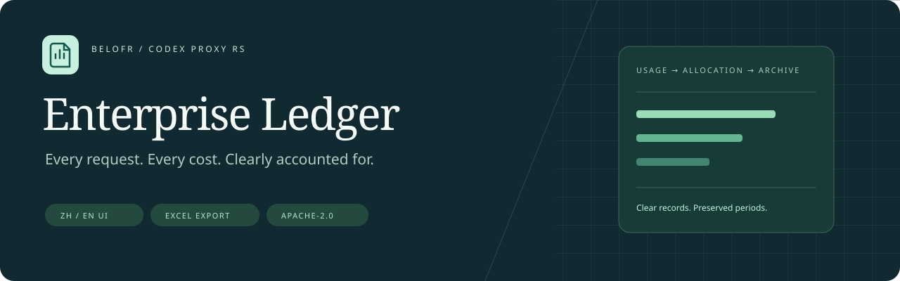
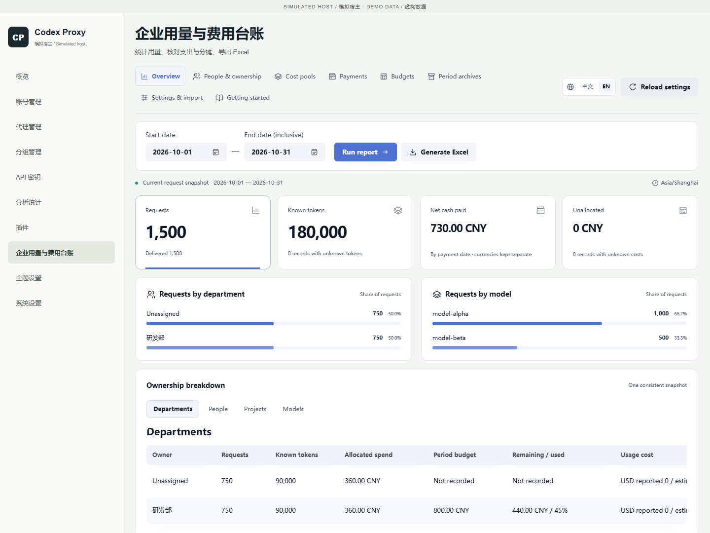

<p align="center"></p>
<h1 align="center">Enterprise Ledger</h1>
<p align="center">Every AI request. Every cost. Clearly accounted for.</p>
<p align="center"><a href="README.md">简体中文</a> · <strong>English</strong></p>
<p align="center"><a href="https://github.com/BELOFR/codex-proxy-enterprise-ledger/releases"></a> <a href="LICENSE"></a>  </p>



A **native Codex Proxy RS plugin** for finance teams, business owners and managers. Turn retained gateway usage into employee, department, project and model reports; record actual payments, allocate shared costs, compare budgets and preserve period snapshots.

**[Download](https://github.com/BELOFR/codex-proxy-enterprise-ledger/releases/latest)** · **[Installation](docs/installation.en.md)** · **[Usage guide](docs/usage.en.md)** · **[Verification](docs/verification.md)** · **[Issues](https://github.com/BELOFR/codex-proxy-enterprise-ledger/issues)**

## See the workspace

Version 0.2.1 uses horizontal tabs and the host's available content width. The plugin has no second sidebar or oversized page header; colors and backgrounds follow the host theme.



> Screenshots show the actual compiled plugin inside an explicitly labelled simulated host shell, with fictional data. Horizontal tabs share the host content area without a second sidebar. Switch Chinese and English at the top right. Light/dark host themes and narrow screens are supported. Language changes preserve report data and draft inputs. Excel retains its seven Chinese worksheets.

## What it does

| Feature | Purpose |
| --- | --- |
| Usage overview | Requests, delivered usage, known tokens, missing costs and department/model distributions |
| Ownership history | Map stable Client Key IDs to employees, departments and projects with effective dates |
| Actual payments | Record subscriptions, API settlements, recharges and refunds; validate and deduplicate CSV imports |
| Cost allocation | Allocate by tokens, cost weights or manual percentages; retain unresolved costs as unallocated |
| Budgets | Department/project budgets, remaining amounts and utilization in matching periods and currencies |
| Excel | Seven worksheets covering overview, people, projects, allocations, requests, payments and rules |
| Period archives | Preserve the report and its original configuration; reopen without scanning; save adjustments separately |
| Bilingual interface | Navigation, metrics, forms, tables, feedback and an in-app workflow guide |

Access uses the **host administrator account**. Separate finance/manager logins and department permissions are not provided. Payments come from manual entry or CSV, not bank or invoice integrations.

## Install the plugin package

**Requirements:** Codex Proxy RS `>=3.49.0, <4.0.0`; Linux x86_64; glibc `>=2.34` and `libgcc_s`. Built and executed on Debian 12. This binary does not support Alpine/musl, Windows or ARM64.

1. From [Releases](https://github.com/BELOFR/codex-proxy-enterprise-ledger/releases/latest), download `belofr.enterprise-ledger-0.2.1-x86_64-unknown-linux-gnu.tar.gz` and its `.sha256` file.
2. Verify SHA-256. Keep the package compressed; no browser extension is needed.
3. Sign in as a gateway administrator. Open **Plugin management → Install plugin → Upload package**, then select the `.tar.gz`.
4. Validate the package. Check `belofr.enterprise-ledger`, version, Linux x64 target and source; review the trust statement and confirm installation.
5. Confirm the plugin is enabled, then open its **Enterprise usage and cost ledger** management page. The host may retain the Chinese page title; the plugin itself has a language selector.

GitHub’s automatic `Source code` downloads and `enterprise-ledger-…-source.zip` are **not installable plugin packages**. See the [installation guide](docs/installation.en.md) for checksum commands, upgrades and troubleshooting.

## First-run workflow

| Step | Page | Action |
| --- | --- | --- |
| 01 | People & ownership | Read the Key list; assign stable IDs, people, departments, projects and effective dates |
| 02 | Cost pools | Create pools with matching rules and an allocation basis; avoid overlapping matches |
| 03 | Payments | Enter the pool, currency, payment date, amount, allocation base and expense period |
| 04 | Budgets, optional | Add matching department/project names, currency and period budgets |
| 05 | Overview | Query a period; review unassigned requests, unknown costs and unallocated amounts |
| 06 | Generate Excel | Generate → Get download link → Open download; on HTTP hosts, copy the address into a new tab |
| 07 | Save period snapshot | Name and close the period; reopen later from Period archives |

**Date boundaries:** report end dates are **inclusive**. Ownership, payment periods and budgets use an **exclusive** end. For October, query `2026-10-01` through `2026-10-31`, but enter `2026-10-01` through `2026-11-01` for the payment’s expense period.

The [usage guide](docs/usage.en.md) includes a worked `720.00 CNY` subscription example, manual shares, refunds, CSV imports, budgets and period closing. Usage reports also work before you record any payments.

## Accounting definitions

Provider-reported and locally estimated costs describe saved request usage. Actual payments describe recorded cash flow. The allocation base describes confirmed management expense for a period. These amounts are shown separately.

Currencies are never summed together or automatically converted. Recharge allocation bases must be zero; record consumption settlement separately. Refunds are negative and reference an original payment. Missing weights and zero denominators leave amounts unallocated. For each currency, **allocated + unallocated = period allocation base**. This management ledger does not replace supplier statements or accounting vouchers.

## Limits and validation

- Only retained native request records are scanned. External aggregates without request details are excluded. The host defaults to 31 days of retention; configure longer retention in advance for quarterly/yearly reporting.
- Query 1–366 days and up to 50,000 records. The page previews 100 rows; Excel includes the complete query.
- Export files last 10 minutes. Download links last two minutes and can be used once. Temporary exports are cleared on plugin restart.
- Up to 24 online archive versions, subject to a 256 KiB compressed / 8 MiB decoded overall state limit. Keep older Excel exports separately before removing archives.
- Core tests, real plugin process protocol checks and sandbox browser interactions have passed. The plugin has not been installed into your actual gateway, and files have not been opened in Excel/WPS. See [verification](docs/verification.md).

## Build

Use Node.js 24, pnpm 11.25.0 and Rust 1.99.1 with Rustfmt and Clippy. The SDK and official packager use a pinned host commit; lockfiles preserve dependency versions.

```bash
git clone https://github.com/BELOFR/codex-proxy-enterprise-ledger.git
cd codex-proxy-enterprise-ledger
pnpm --dir frontend install --frozen-lockfile
pnpm --dir frontend lint
pnpm --dir frontend build
bash scripts/package-linux.sh
```

Run these commands on Linux x64. On Windows with Docker Desktop already running, use `pwsh -File scripts/package.ps1`. Outputs go to `dist/`; the script does not start Docker automatically.

Maintained by **BELOFR**, licensed under [Apache-2.0](LICENSE). Built on the public [Codex Proxy RS SDK](https://github.com/zyycn/codex-proxy-rs) and [Codex Proxy UI](https://github.com/zyycn/codex-proxy-ui). See [third-party notices](THIRD_PARTY_NOTICES.md). Contributions and reproducible bug reports are welcome; redact credentials and company financial data before sharing.
