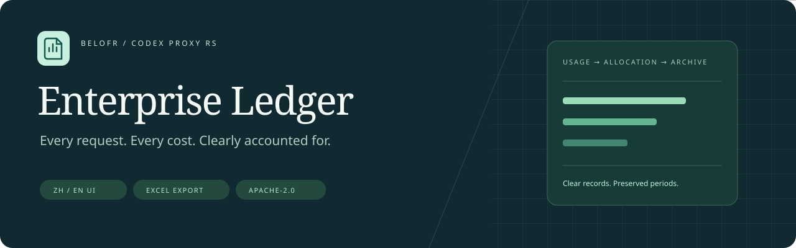
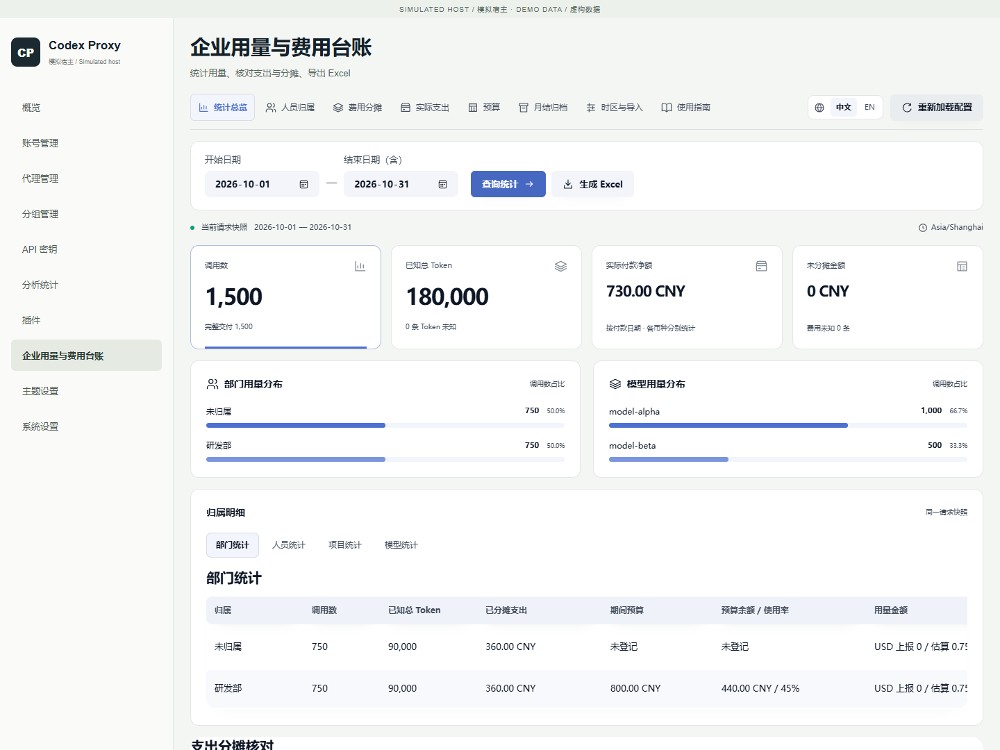
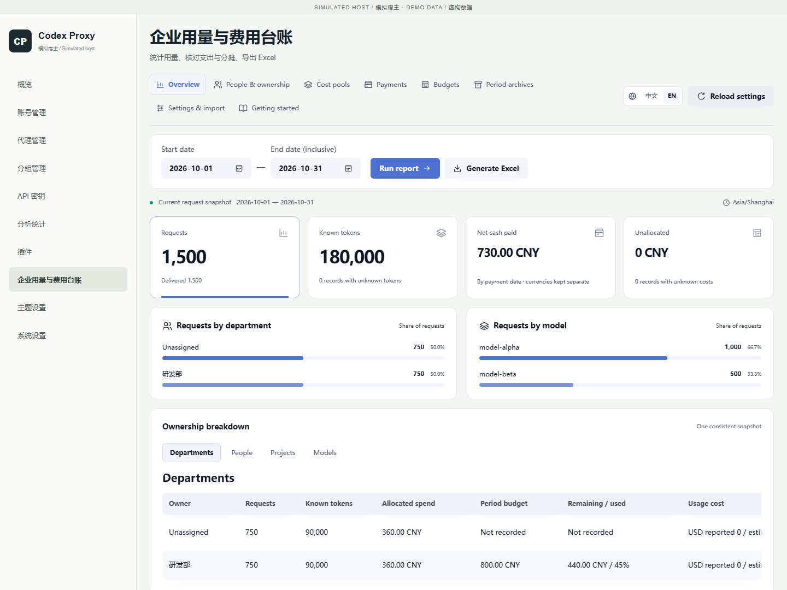
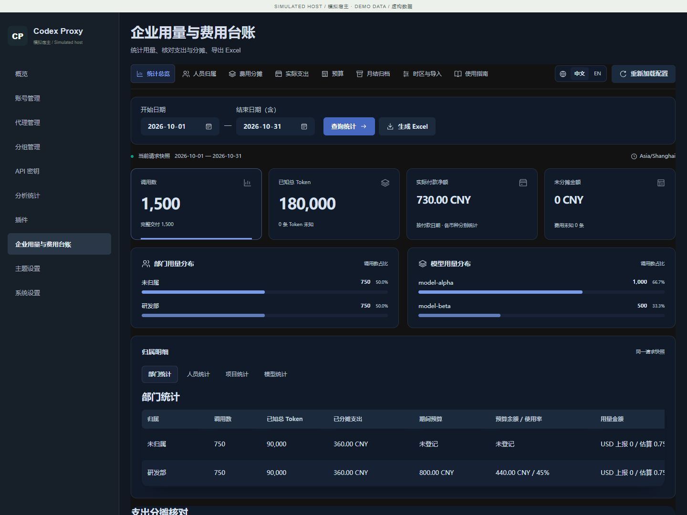
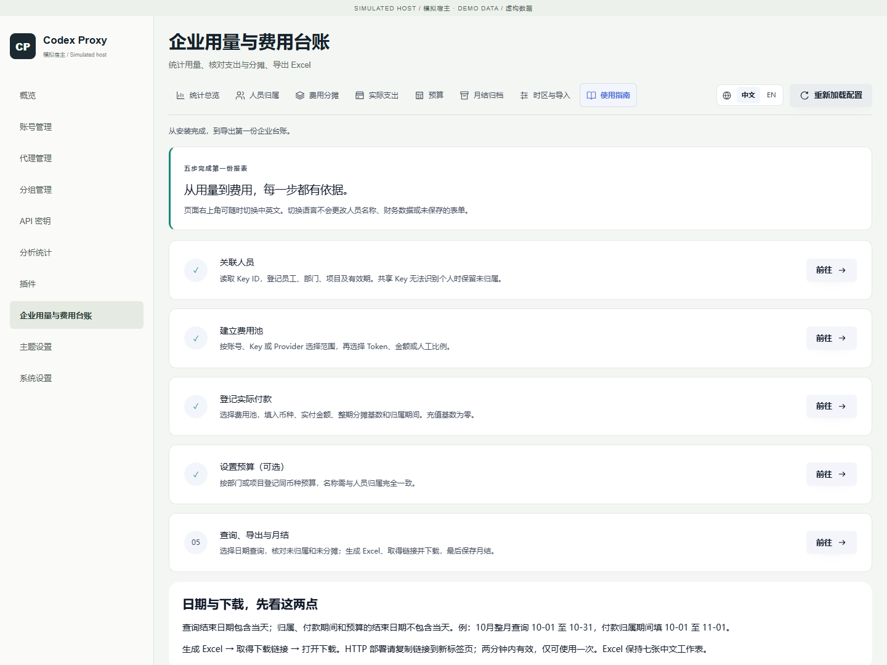

<p align="center"></p>
<h1 align="center">Enterprise Ledger · 企业用量与费用台账</h1>
<p align="center">把每一次 AI 调用，变成看得清、可核对、能归档的企业账。</p>
<p align="center"><strong>简体中文</strong> · <a href="README.en.md">English</a></p>
<p align="center"><a href="https://github.com/BELOFR/codex-proxy-enterprise-ledger/releases"></a> <a href="LICENSE"></a>  </p>



**Codex Proxy RS 原生插件**，为财务、业务负责人和管理者整理 AI 用量与费用：按人员、部门、项目、模型统计，登记真实付款，分摊共享成本，比较预算，导出 Excel 并保留月结快照。

**[下载最新安装包](https://github.com/BELOFR/codex-proxy-enterprise-ledger/releases/latest)** · **[安装与升级](docs/installation.zh-CN.md)** · **[完整使用流程](docs/usage.zh-CN.md)** · **[验证记录](docs/verification.md)** · **[反馈问题](https://github.com/BELOFR/codex-proxy-enterprise-ledger/issues)**

## 界面预览

v0.2.1 使用顶部功能标签，插件不再重复绘制侧栏和大标题，内容占满宿主可用区域，背景与配色跟随宿主主题。



> 截图来自真实编译的插件页面，外围为明确标记的模拟宿主导航，用于检查嵌入后的布局；数据均为虚构。右上角可切换中文／English，支持深浅色主题和窄屏。切换语言保留当前报表及表单输入；Excel 仍为七张中文工作表。

<details><summary>查看英文界面、深色主题和使用指南</summary>





</details>

## 能做什么

| 功能 | 实际用途 |
| --- | --- |
| 用量总览 | 调用数、完整交付数、已知 Token、费用缺失、部门与模型分布 |
| 人员与组织归属 | 用稳定 Key ID 关联员工、部门和项目；按生效期间追溯调岗历史 |
| 实际支出 | 登记订阅、API 结算、充值、退款；支持 UTF-8 CSV 整批校验和去重 |
| 费用分摊 | 以 Token、金额或人工比例分配成本；异常保留未分摊，逐币种核对 |
| 预算比较 | 部门／项目预算、余额、使用率，按相同期间和币种比较 |
| Excel 导出 | 总览、部门人员、项目、分摊、请求明细、实付、归属规则七张表 |
| 月结归档 | 保存当时的数据、规则和归属；重新打开不重新扫描，调整另存版本 |
| 中英文展示 | 导航、指标、表格、表单、操作提示、内置流程指南即时切换 |

当前通过**宿主管理员入口**使用和导出，可将报表交给财务或业务同事。暂未提供独立财务／老板账号或部门数据权限隔离，也不会自动获取银行流水或供应商发票。

## 安装：上传这个包

**运行要求：** Codex Proxy RS `>=3.49.0, <4.0.0`；Linux x86_64；glibc `>=2.34`，需 `libgcc_s`。Debian 12 下构建及运行验证通过。Alpine/musl、Windows、ARM64 不能使用这个安装包。

1. 打开 [Releases](https://github.com/BELOFR/codex-proxy-enterprise-ledger/releases/latest)，下载 `belofr.enterprise-ledger-0.2.1-x86_64-unknown-linux-gnu.tar.gz` 和旁边的 `.sha256`。
2. 核对 SHA-256。包保持压缩状态，不需要解压，也不需要安装浏览器扩展。
3. 用管理员账号打开网关，进入**插件管理 → 安装插件 → 上传包**，选择上述 `.tar.gz`。
4. 先校验安装包，核对插件 ID `belofr.enterprise-ledger`、版本、Linux x64 平台及来源，阅读信任说明后确认安装。
5. 安装完成后确认插件状态为已启用，从插件的管理页面入口打开**企业用量与费用台账**。

`Source code (zip)`、`Source code (tar.gz)` 和 `enterprise-ledger-…-source.zip` 都是源码，**不能作为插件包上传**。完整步骤、校验命令、升级方式及故障排查见 [安装指南](docs/installation.zh-CN.md)。

## 第一次使用：照这个顺序

| 步骤 | 去哪里 | 要做什么 |
| --- | --- | --- |
| 01 | 人员归属 | 点击「读取 Key 列表」，复制稳定 Key ID，登记员工、部门、项目和生效日期 |
| 02 | 费用分摊 | 新建费用池，设置匹配条件和分摊依据；避免同一请求匹配多个池 |
| 03 | 实际支出 | 选择费用池，登记实付金额、币种、付款日、分摊基数和归属期间 |
| 04 | 预算（可选） | 输入与归属完全一致的部门／项目名、同币种预算与期间 |
| 05 | 统计总览 | 选择日期并查询，核对未归属、未知费用与未分摊 |
| 06 | 生成 Excel | 点击「生成 Excel → 取得下载链接 → 打开下载」；HTTP 环境复制地址到新标签页 |
| 07 | 保存月结版本 | 填写名称，保存快照；后续到「月结归档」查看和再次导出 |

**日期容易填错：** 查询结束日期**包含当天**；归属、付款期间和预算结束日期**不包含当天**。例如查询十月填 `2026-10-01 ～ 2026-10-31`，十月费用归属填 `2026-10-01 ～ 2026-11-01`。

完整教程含一笔 `720.00 CNY` 的订阅费示例、人工比例、退款、CSV 模板、预算与月结说明：[阅读使用指南](docs/usage.zh-CN.md)。只有用量、还没登记付款时，也可以直接查询用量统计。

## 费用怎么理解

| 数字 | 含义 |
| --- | --- |
| 上游报告／本地估算 | 请求当时由宿主保存的用量金额，保留原币种和来源 |
| 实际付款 | 手工或 CSV 登记的现金流，按付款日期统计 |
| 期间分摊基数 | 经确认归属当前期间的管理成本，跨期金额按日历天分配 |
| 已分摊 + 未分摊 | 两者按币种分别加总，等于本期分摊基数 |

不同币种不相加，不自动换汇。充值的费用分摊基数必须为零，消费结算另记，避免重复计费；退款填负数并关联原付款。缺费用、缺 Token 或零分母时保留未分摊。具体定义、舍入及容量见 [核算与容量参考](docs/accounting-reference.zh-CN.md)。本插件的管理台账不能代替供应商结算单或正式会计凭证。

## 使用前应知道

- 只统计宿主仍保留的原生请求，不包含无请求明细的外部聚合贡献。宿主默认保留31天，季度和年度查询应提前调整保留设置，已清理数据无法恢复。
- 单次查询1～366天、最多50,000条；页面预览100条，Excel 导出完整查询范围。
- 下载文件保留10分钟；取得的链接有效两分钟且只能使用一次。插件重启会清除临时文件，重新生成即可。
- 在线月结最多24个版本，且受压缩后256 KiB、解压后8 MiB整体台账上限约束；达到容量时先下载并保存旧报表，再移除旧归档。
- 已完成真实插件进程、模拟宿主协议和浏览器沙箱验收；未安装到你的实际网关，尚未在 Excel/WPS 应用中验收。详见 [验证记录](docs/verification.md)。

## 从源码构建

工具链：Node.js 24、pnpm 11.25.0、Rust 1.99.1（含 Rustfmt、Clippy）。SDK 与官方打包工具固定提交，依赖版本由锁文件保存。

```bash
git clone https://github.com/BELOFR/codex-proxy-enterprise-ledger.git
cd codex-proxy-enterprise-ledger
pnpm --dir frontend install --frozen-lockfile
pnpm --dir frontend lint
pnpm --dir frontend build
bash scripts/package-linux.sh
```

以上构建命令在 Linux x64 下运行。Windows 已安装并运行 Docker Desktop 时，执行 `pwsh -File scripts/package.ps1`；脚本不会替你启动 Docker。生成文件位于 `dist/`。

| 目录 | 内容 |
| --- | --- |
| `backend/` | Rust 插件、精确金额计算、XLSX 与领域测试 |
| `frontend/` | Vue 管理页面、语言切换、图标与主题 |
| `docs/` | 安装、使用、核算、验证及截图 |
| `examples/` | CSV 付款模板 |
| `scripts/` | 构建、打包、完整性与协议检查 |

## 参与和许可

欢迎通过 [Issues](https://github.com/BELOFR/codex-proxy-enterprise-ledger/issues) 提交问题或需求，说明宿主版本、插件版本和复现步骤；提交日志或图片前请隐藏 Key、令牌和公司财务数据。

由 **BELOFR** 维护，采用 [Apache-2.0](LICENSE) 许可证。基于 [Codex Proxy RS](https://github.com/zyycn/codex-proxy-rs) 公开 SDK 与 [Codex Proxy UI](https://github.com/zyycn/codex-proxy-ui) 构建，第三方许可见 [THIRD_PARTY_NOTICES.md](THIRD_PARTY_NOTICES.md)。
