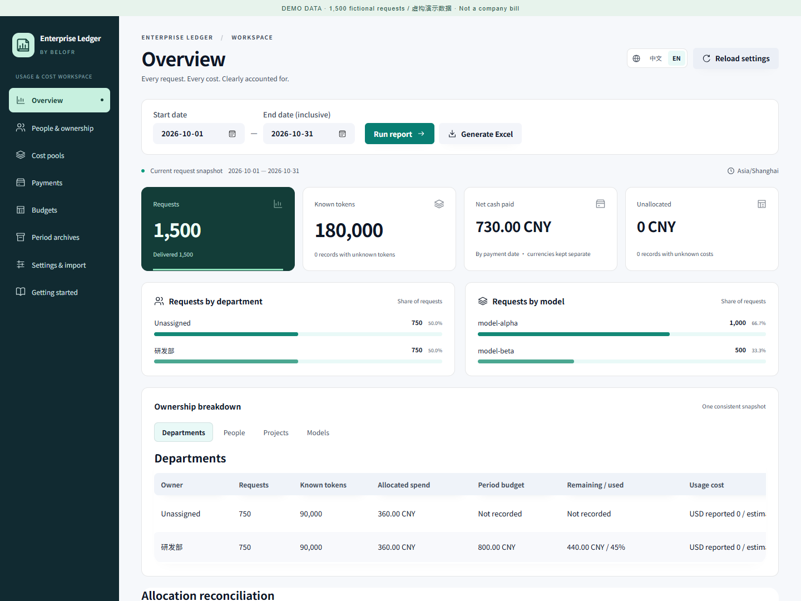

# Your first enterprise ledger

[README](../README.en.md) · [简体中文](usage.zh-CN.md) · [Installation](installation.en.md)

Switch **中文 / EN** at the top right. User-entered names and vouchers are never translated. If the host sandbox disables browser storage, language selection lasts for the current page; a reload follows browser language again. Excel retains seven Chinese worksheets.

## Prepare

Have a period with retained request records, stable Client Key IDs, ownership history, payment evidence, currencies, expense periods and confirmed allocation rules. Budgets are optional. The plugin cannot recover deleted host records or fetch bank transactions automatically.

This walkthrough uses a **fictional 720.00 CNY October subscription**. Replace all sample information with verified company facts.

## 1. People & ownership

Click **Read Key list**, copy the stable Key ID and create an assignment:

| Field | Example |
| --- | --- |
| Assignment ID | Keep the generated ID, or use `assignment-alex` |
| Client Key ID | Copy an actual stable ID, never a Key secret |
| Employee | Alex |
| Department | Engineering |
| Project | Audit Assistant |
| Period start | `2026-10-01` |
| Effective end | Leave empty for ongoing ownership |

Click **Save record**. Use **New record** for another assignment. Shared Keys without reliable individual identity should remain Unassigned. A Key cannot have overlapping ownership periods.

For a transfer on November 1, end the old assignment at `2026-11-01` and create another starting that day. October requests retain the old department, and saved archives keep their original assignments.

## 2. Cost pools

Create a pool with ID `pool-example`, name `October shared subscription`, basis **Total tokens** and manual shares `[]`. Fill the actual account/Key IDs and Provider when you need to limit the pool; comma-separate multiple IDs.

Account, Key and Provider conditions apply together. Empty filters are unrestricted; a nonmanual pool with all filters empty matches all requests. Overlapping pool matches reject a report, so keep pool scopes distinct.

| Basis | Requirement |
| --- | --- |
| Total tokens | Complete token weights; confirm that equal token weighting across models is suitable |
| Known usage cost | Complete cost weights in one currency |
| Manual percentages | Positive confirmed shares totaling 100 |

Missing weights, mixed cost-weight currencies or a zero denominator keep the base **unallocated**. Manual example:

```json
[
  {"person":"Alex","department":"Engineering","project":"Audit Assistant","percent":"60"},
  {"person":"Sam","department":"Sales","project":"Presales","percent":"40"}
]
```

Choose manual basis before entering shares. A manual pool without filters allocates payments without claiming request ownership. Usage-based weights come from eligible records both within the current query and the payment’s expense period; changing query coverage can change weights.

## 3. Payments

Create a payment after the referenced pool exists:

| Field | Example |
| --- | --- |
| Payment ID | `payment-example-1` |
| Payment date | `2026-10-01` |
| Supplier / voucher | Example supplier / `EXAMPLE-001` |
| Category / pool | Subscription / `pool-example` |
| Currency | CNY |
| Paid amount | `720.00` |
| Full-period allocation base | `720.00` |
| Period start / exclusive end | `2026-10-01` / `2026-11-01` |
| Original payment ID | Empty for ordinary payments |

The paid amount describes cash movement; the base describes confirmed management expense. A cross-period base is prorated by calendar days into the selected query. Querying 10 days of a 31-day 720 CNY expense period produces `720 × 10 / 31`, rounded to currency precision.

**Recharge:** enter the paid amount but a zero allocation base. Record consumption settlement separately to avoid counting both as expense.

**Refund:** use the Refund category, negative paid/base amounts, the original payment ID and matching pool/currency. Finance confirms the refund’s expense period; the plugin does not assume the current user should bear a historic refund.

### CSV import

1. Download [the payment template](../examples/payments.csv). Its sample rows are fictional; replace them before real use.
2. Create `pool-example`, or replace it with an existing pool ID in every row.
3. Keep the English header, use UTF-8 and `YYYY-MM-DD`, and omit currency symbols/thousands separators from numeric fields.
4. Open **Settings & import**, choose a file or paste its contents, then click **Validate & import**.
5. Check the success message and verify the rows in Payments.

Duplicate payment IDs and nonempty supplier/voucher pairs are rejected. One invalid row rejects the whole batch. Importing the same file again does not increase payments. CSV import appends validated records; saving Configuration JSON replaces the current configuration.

## 4. Budgets, optional

Create a Department budget named exactly `Engineering`, currency CNY, amount `800.00`, period `2026-10-01` to `2026-11-01`. Project budgets likewise require an exact project-name match.

Budgets compare with same-currency allocated spend. Unallocated costs remain separate. A zero budget has no utilization percentage. If Engineering receives 360 CNY of allocated spend, its remaining budget is 440 CNY and utilization 45%; actual results depend on real weights and rules.

## 5. Query and reconcile

In **Overview**, query `2026-10-01` through `2026-10-31`. Configure the IANA report time zone in Settings, for example `Asia/Shanghai`.



- Check requests, delivered usage and known tokens. Unknown values are distinct from known zero.
- Review net cash paid and unallocated amounts. Cash follows payment dates; allocation follows expense periods.
- Department/model bars show **request-count share**, with the top four groups and an Other remainder. They do not compare amounts across currencies.
- Switch Ownership breakdown between Departments, People, Projects and Models. Review allocated spend, budgets and missing-cost counts.
- In Allocation reconciliation, verify allocated + unallocated = period base for each currency.
- Expand Cost definitions & data coverage and Request details. The page previews 100 rows, while the complete scan/export allows up to 50,000.

Report totals and export use the same request snapshot. An incomplete scan cannot masquerade as a complete report. External aggregates without request details are excluded.

## 6. Export Excel

1. Click **Generate Excel** and wait for confirmation.
2. Click **Get download link**.
3. On HTTPS hosts, click **Open download** and follow the host’s link confirmation.
4. On HTTP hosts, copy the one-time address and open it in a new browser tab.
5. Keep the workbook according to company financial-data rules and confirm its period/currencies.

Seven Chinese worksheets cover overview, departments/people, projects, allocations, request details, actual payments and ownership/rules. Model statistics appear in the overview. This is a values snapshot; editing Excel does not rescan or recalculate the plugin report.

Generated files last 10 minutes; tickets last two minutes. A successful delivery removes the cached file. Regenerate after expiration or plugin restart. Anyone holding a valid link can download that report, so treat it as financial data.

## 7. Close and archive

At the bottom of Overview, enter an archive name such as `2026-10 close`, then **Save period snapshot**. The request facts, report and original settings are preserved together.

- **Reopen:** Period archives → View & export; no new scan occurs.
- **Adjust:** edit current settings, run a new report and save another version with an adjustment reason for the repeated period.
- **Conflict:** reload/requery before writing; do not automatically replay financial changes after a conflict.
- **Remove:** export and keep Excel first, then Remove archive and confirm. Payments/current configuration remain, but that online snapshot cannot be restored.

Up to 24 archives are supported, subject to a 256 KiB compressed / 8 MiB decoded overall ledger limit. Shorten periods or keep older exports separately before removing online archives. Do not use online snapshots as your only backup.

## Share with the right audience

Finance can review payments, vouchers, allocations and close versions. Business owners can inspect departmental/project usage and budgets. Managers can review the overview, request distributions, cash paid and unresolved costs.

These are views of one ledger, not separate account permissions. Follow company policy when selecting recipients and sharing exports. Detailed accounting definitions and capacity limits are in the [reference](accounting-reference.zh-CN.md).
