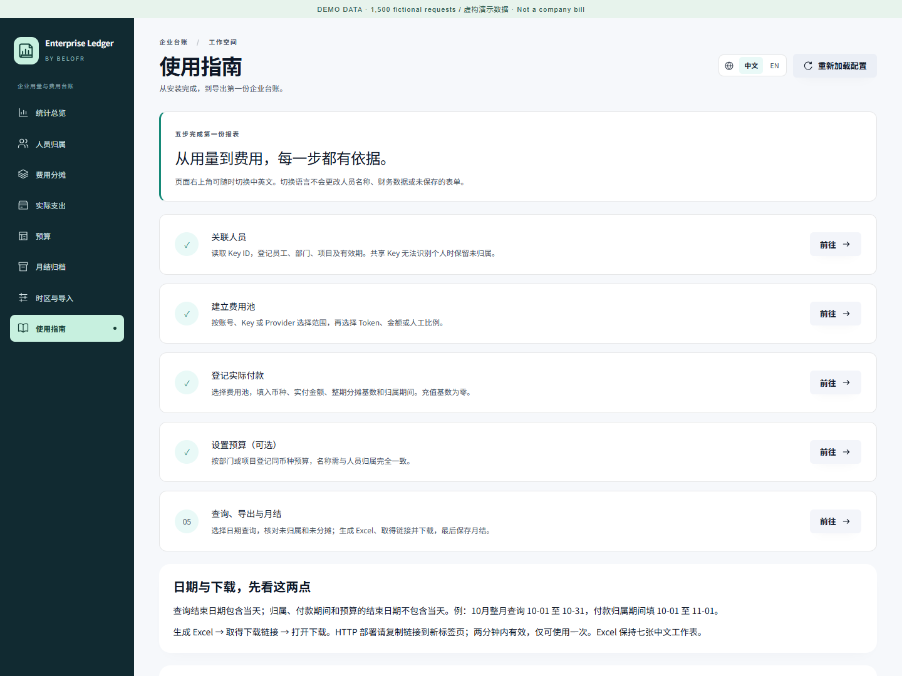
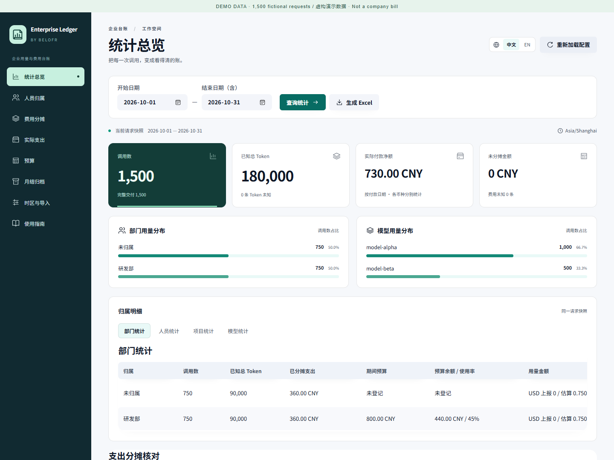

# 从零到第一份企业台账

[返回 README](../README.md) · [English](usage.en.md) · [先安装插件](installation.zh-CN.md)

本指南按真实操作顺序说明。界面右上角可切换「中文 / EN」；用户录入的员工、部门、项目和凭证不会被翻译。宿主沙箱可能不允许浏览器存储，此时语言选择在当前页面生效，刷新后按浏览器语言重新选择。Excel 暂时保持七张中文工作表。



## 先准备这些资料

- 有用量记录的日期范围；确认宿主明细尚未被清理。
- 员工使用的稳定 **Client Key ID** 及对应部门／项目；不要使用 Key 明文或可改名的显示名称作为关联依据。
- 供应商付款或账单凭证、币种、付款日和实际支出金额。
- 该笔费用属于哪段期间、哪个共享账号／费用池，采用什么分摊依据。
- 可选：部门或项目预算。

下面用**虚构十月订阅费720.00 CNY**贯穿流程。真实付款由你的凭证决定，插件不会自动读取银行、发票或订阅支付记录。

## 01 · 关联员工、部门和项目

进入「人员归属」，点击「读取 Key 列表」，找到员工使用的 Key 并复制其稳定 ID。填写一条记录：

| 字段 | 示例 | 说明 |
| --- | --- | --- |
| 归属ID | 自动生成，或 `assignment-alex` | 插件记录的唯一 ID |
| Client Key ID | 从真实 Key 列表复制 | 不是 Key 明文 |
| 员工 | 张三 | 用于人员汇总 |
| 部门 | 研发部 | 预算名称需与此完全一致 |
| 项目 | 审计助手 | 项目汇总与预算依据 |
| 归属开始（含） | `2026-10-01` | 开始当天生效 |
| 生效结束（不含，可留空） | 留空 | 表示持续生效 |

点击「保存记录」。增加其他员工时点击「新增」，不要沿用已有归属 ID。多人共用一个 Key 且没有可靠事实区分时，不要猜测个人；保留「未归属」，或改用员工／项目独立 Key。

**调岗示例：** 11月1日从研发部调到产品部，把旧记录结束设为 `2026-11-01`，再新增11月1日开始的新记录。同一个 Key 的有效期不能重叠，十月历史请求仍归研发部。已保存的月结不被这些修改覆盖。

## 02 · 建立费用池与规则

进入「费用分摊」，创建：

| 字段 | 示例 |
| --- | --- |
| 费用池ID | `pool-example` |
| 名称 | 十月共享订阅 |
| 分摊依据 | 按总 Token |
| Provider | 可留空；需要限制时填写宿主实际值 |
| 账号ID／Key ID | 按实际共享范围填写，多个用英文逗号分隔 |
| 人工比例 JSON | `[]` |

账号、Key、Provider 条件**共同匹配**；留空表示不限制。非人工费用池所有条件留空会匹配全部请求。一个请求匹配多个费用池会拒绝报表，请明确各池的边界。

| 依据 | 适用情况 | 无法分摊时 |
| --- | --- | --- |
| 按总 Token | 确认各模型使用同一 Token 权重可以接受，且池内 Token 齐全 | 未知 Token 或总权重为零，费用保留未分摊 |
| 按已知金额 | 池内每笔合格请求费用齐全，权重币种一致 | 缺费用或混合权重币种时保留未分摊 |
| 按人工比例 | 财务已确认固定比例，不依赖用量 | 比例必须正数且合计100 |

人工比例示例：选择「按人工比例」，填入以下 JSON。`percent` 用十进制字符串，合计100；其他规则不要配置人工比例。

```json
[
  {"person":"张三","department":"研发部","project":"审计助手","percent":"60"},
  {"person":"李四","department":"业务部","project":"售前","percent":"40"}
]
```

人工池不设筛选条件时仅分配付款，不参与请求归池。Token 或金额池的权重只来自本次查询内、同时属于该笔付款归属期间的合格用量；查看不同查询范围时，权重可能不同。

## 03 · 登记实际付款

进入「实际支出」，新增以下虚构记录：

| 字段 | 示例 |
| --- | --- |
| 付款ID | `payment-example-1` |
| 付款日期 | `2026-10-01` |
| 供应商 | 示例供应商 |
| 凭证编号 | `EXAMPLE-001` |
| 类别 | 订阅费 |
| 费用池ID | `pool-example`，必须先建立 |
| 币种 | CNY |
| 实付金额 | `720.00` |
| 整期分摊基数 | `720.00` |
| 归属开始（含） | `2026-10-01` |
| 归属结束（不含） | `2026-11-01` |
| 退款关联原付款 | 留空 |
| 备注 | 按真实凭证填写 |

实付金额反映现金流；分摊基数是财务确认的管理费用，不要求与付款金额永远相同。跨期费用的基数按日历天分配到查询范围。例如一个31天归属期的720元费用只查询其中10天，该次期间基数按 `720 × 10 / 31` 计算并按币种精度处理。

**充值：** 类别选「预付充值」，实付填充值金额，整期分摊基数必须 `0.00`。后续消费结算另行登记，不能把充值和消费再次各算一份费用。

**退款：** 类别选「退款」，填负的实付金额和经确认的负分摊基数，填写原付款 ID，且费用池与币种应和原付款一致。退款归属期间由财务确认，不会自动套用当前员工归属。

### 批量 CSV 导入

1. 下载仓库中的 [付款模板](../examples/payments.csv)。文件是示例数据，使用前替换，或先在测试环境练习。
2. 先创建模板引用的 `pool-example`；真实导入时改成自己的费用池 ID。
3. 保持第一行英文列名不变，保存为 **UTF-8 CSV**，日期填 `YYYY-MM-DD`，金额不带货币符号或千位逗号。
4. 到「时区与导入」，选择文件或粘贴 CSV，点击「校验并导入」。
5. 查看成功提示，再到「实际支出」核对数量和金额。

付款 ID 与非空「供应商＋凭证编号」不能重复。任何一行无效时整批不写入；重复导入同一文件会明确拒绝，不会增加费用。JSON 配置保存会替换当前配置，付款 CSV 则是在校验后追加，两者行为不同。

## 04 · 登记预算（可选）

进入「预算」，选择「部门」，名称填写与归属一致的 `研发部`，币种 CNY，整期预算 `800.00`，期间 `2026-10-01 ～ 2026-11-01`。项目预算选择「项目」并填完全相同的项目名。

预算与**同币种已分摊支出**比较，未分摊费用单独处理。预算零时使用率为不适用；无预算时显示未登记。如果该部门实际分得360元，则余额440元、使用率45%。这是条件示例，实际分摊结果取决于请求和规则。

## 05 · 查询和复核

回到「统计总览」，查询 `2026-10-01 ～ 2026-10-31`。确认报表时区；需要修改时到「时区与导入」，常用中国时区是 `Asia/Shanghai`。



1. 看调用数、完整交付数、已知 Token。未知数据不会被伪装成零。
2. 看实际付款净额和未分摊。付款按付款日，费用基数按归属期间，两者不能机械相加。
3. 看部门和模型分布。条形图以**调用数**计算占比，只显示前四项，其余合并为「其他」，不跨币种比较金额。
4. 在「归属明细」切换部门、人员、项目、模型，检查已分摊支出、预算和缺失覆盖。
5. 核对「支出分摊核对」，各币种满足已分摊＋未分摊＝期间基数。
6. 展开「费用口径与数据范围」和「请求明细」，查看提示和明细预览。页面预览最多100行，完整扫描最多50,000行。

金额、现金和分摊来自同一报表快照。扫描中途失败不会生成可冒充完整结果的报表。宿主已清理的明细无法补回；无明细的外部聚合贡献不包含在此报表中。

## 06 · 导出 Excel

1. 点击「生成 Excel」，等待成功。
2. 点击「取得下载链接」，得到两分钟内有效的一次性地址。
3. HTTPS 部署点击「打开下载」，按宿主的链接确认提示操作。
4. HTTP 部署选择并复制地址，到浏览器新标签页粘贴并打开。不要把一次性地址发到公开群。
5. 下载后按公司的财务文件规则保存，检查查询期间和币种。

文件包含七张表：**统计总览、部门人员、项目汇总、费用分摊、请求明细、实际支出、归属与规则**。模型统计也在总览中。Excel 是查询时的值快照，修改单元格不会让插件重新扫描或自动重算。

生成文件缓存10分钟，下载票据两分钟，成功交付一次后文件被清理。重启或过期时重新生成即可。链接持有者在有效期内可下载，应按财务数据保管。

## 07 · 月结、重开与移除

在统计总览底部填写「月结名称」，例如 `2026-10 月结`，点击「保存月结快照」。此时保存请求、报表和当时的付款／归属／规则。

- **查看历史：** 进入「月结归档 → 查看与导出」，返回已保存的快照，不重新扫描。
- **后续调整：** 修改当前配置后重新查询，同一期间再次保存须填写调整说明，原版本保留。
- **冲突：** 他人保存过配置或你在查询后修改过规则时，重新加载／重新查询后再操作，不自动重放财务写入。
- **移除归档：** 先另行保存 Excel，再点「移除归档」，阅读弹窗并确认。删除的是在线月结版本，付款和当前配置保留；删除版本无法恢复。

在线归档最多24个，整体台账压缩后最多256 KiB、解压后8 MiB，以先到的上限为准。达到上限时缩小查询范围或导出并移除旧版本，不要依赖在线归档作为唯一备份。

## 交付给不同角色

| 角色 | 建议看哪些内容 |
| --- | --- |
| 财务 | 实际支出、凭证编号、费用分摊、币种与归属期间、月结版本 |
| 业务负责人 | 人员／部门／项目用量、支出归属、未分摊异常、预算使用率 |
| 管理者 | 总览、部门与模型占比、实际付款净额、预算及归档结果 |

这些是同一套台账的查看方式，并不是账号权限隔离。分享报表前按公司规定限制数据范围和文件接收人。
